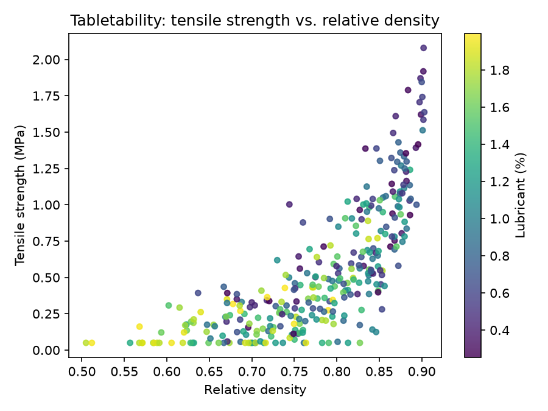
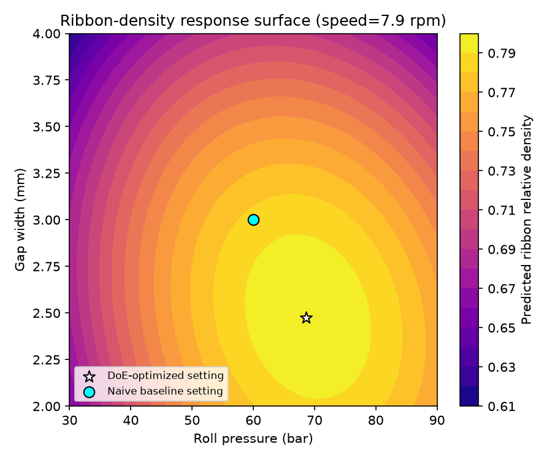

# Tablet Manufacturability & Roller Compaction DoE

Process modeling and design of experiments (DoE) for solid-dose tablet
manufacturing: (1) a tabletability/compressibility model predicting tensile
strength from powder-blend attributes, and (2) a central composite design
(CCD) that optimizes roller compaction ribbon density and reduces process
variability.

## Project structure

```
simulate_blend_data.py       # simulate 300+ powder-blend records (Kawakita + Ryshkewitch-Zapas)
model_tensile_strength.py    # regression model: tensile strength from blend features
design_ccd.py                # 30-run face-centered CCD construction (3 factors)
optimize_ribbon_density.py   # response-surface simulation, quadratic fit, optimum, variability
plot_response_surface.py     # figures
run_all.py                   # runs the full pipeline end-to-end
tests/test_pipeline.py       # pytest sanity checks
data/                        # generated CSVs
output/                      # generated JSON results + figures
```

## Part 1 — Tabletability & compressibility modeling

**Data.** 320 simulated powder-blend records with four process/formulation
features: particle size (D50, 20-250 um), compression force (5-35 kN),
lubricant level (0.25-2.0% w/w), and moisture content (1-5% w/w).

**Physical model.** Relative density is generated from compression force via
a **Kawakita-style densification relationship**:

```
rho_r = rho_0 + (1 - rho_0) * (C * P) / (1 + C * P)
```

Tensile strength is then generated from relative density via the
**Ryshkewitch-Zapas relationship**:

```
sigma = sigma_0 * exp(-k * (1 - rho_r))
```

Particle size, lubricant %, and moisture % modulate `rho_0`, the Kawakita
constant `C`, the zero-porosity strength `sigma_0`, and the bonding
constant `k`, consistent with documented compaction behavior (finer
particles and higher lubricant levels reduce bonding strength; moisture
has a plasticizing effect on densification). Gaussian noise is added to
represent measurement/batch variability.

**Model.** A degree-2 polynomial-feature Ridge regression (compared against
a RandomForest) is fit on the four raw features and evaluated on a 25%
held-out split.

**Result (actual run):**
```
polynomial_ridge_r2: 0.8835   <- selected model
random_forest_r2:    0.8162
n_train: 240, n_test: 80
```



## Part 2 — Roller compaction DoE

**Design.** A 30-run **face-centered central composite design** (CCD) was
constructed from first principles for three roller-compaction factors:

| Factor | Low (-1) | High (+1) |
|---|---|---|
| Roll pressure (bar) | 30 | 90 |
| Roll speed (rpm) | 5 | 15 |
| Gap width (mm) | 2 | 4 |

The CCD combines a full 2^3 factorial (8 runs), 2x3 axial/star points at
alpha=1 (6 runs, face-centered), and 16 replicated center points, for 30
runs total. The large number of center-point replicates gives a robust
estimate of pure error at the nominal operating point.

**Response simulation.** Ribbon relative density is simulated from a
realistic second-order (Johanson-style) response surface with a true
interior optimum: density rises with pressure and falls with gap width up
to a point, but over-compaction causes ribbon cracking/capping that
produces a genuine interior maximum (not a boundary optimum) — consistent
with published roller-compaction RSM studies.

**Fit.** A quadratic response-surface model (linear regression over degree-2
polynomial features of the 3 factors) is fit to the 30 simulated runs.

**Result (actual run):**
```
Quadratic RSM R^2: 0.998
Optimum: roll pressure = 68.6 bar, roll speed = 7.9 rpm, gap width = 2.47 mm
Predicted ribbon relative density at optimum: 0.798
```



**Variability reduction.** Real production equipment cannot hold
pressure/speed/gap perfectly constant (feeder and hydraulic control
tolerance). We Monte Carlo-propagate realistic input jitter (+/-2 bar,
+/-0.5 rpm, +/-0.05 mm) through the fitted response surface at (a) a naive
mid-range baseline setting (60 bar, 10 rpm, 3 mm) and (b) the DoE-optimized
setting. Because the optimum sits near a local maximum of the response
surface, the local gradient is flatter there, so the same input jitter
produces less output variation — the standard robust-parameter-design
rationale for DoE-based process optimization.

**Result (actual run):**
```
Baseline setting std (ribbon density):  0.00950
Optimized setting std (ribbon density): 0.00601
Variability reduction: 36.7%
```

## Running it

```bash
pip install -r requirements.txt
python run_all.py
pytest tests/ -v
```

## Test results (actual run)

```
5 passed in 9.29s
```

## Key numbers (summary)

| Metric | Result |
|---|---|
| Powder-blend records simulated | 320 |
| Tensile-strength model R^2 (held out) | 0.883 |
| CCD design | 30 runs (8 factorial + 6 axial + 16 center) |
| Quadratic RSM R^2 | 0.998 |
| Ribbon-density variability reduction | 36.7% |
